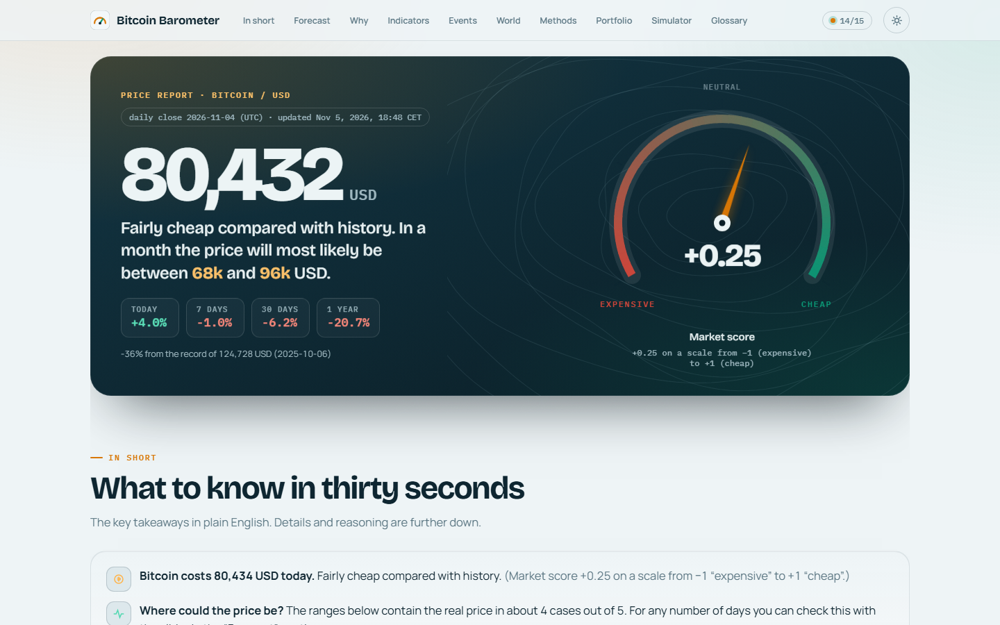
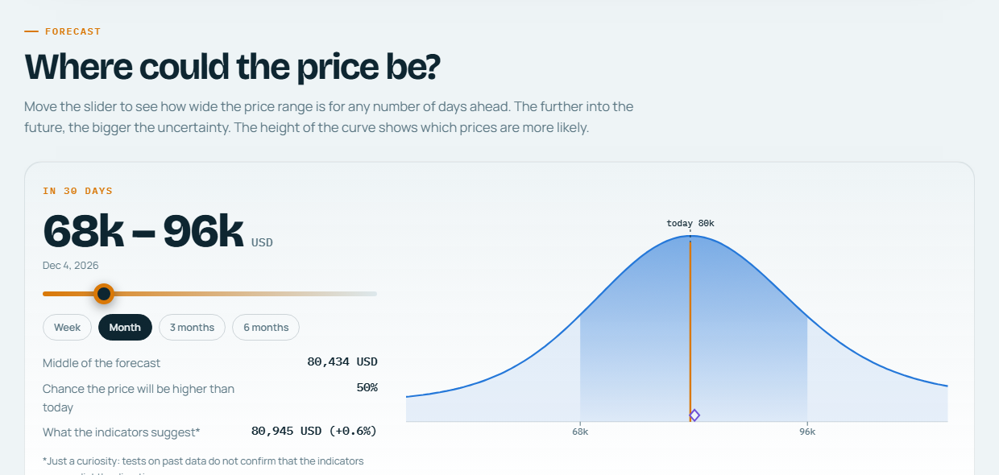
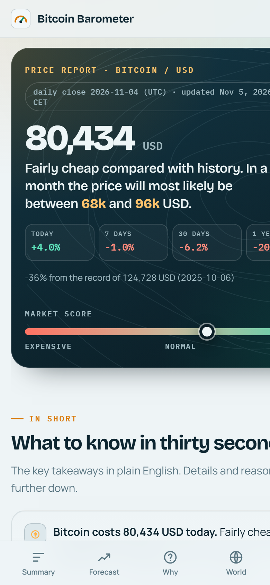
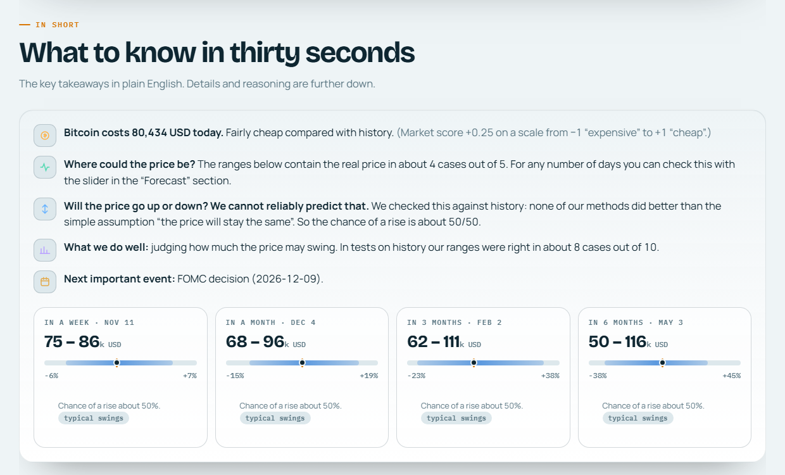
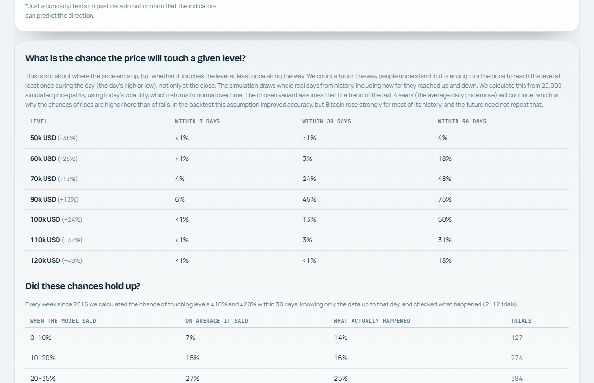
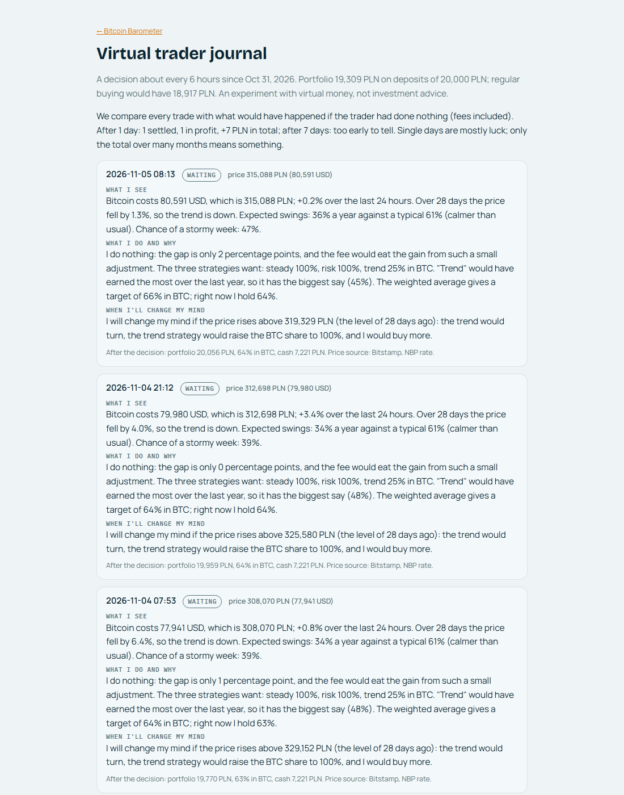
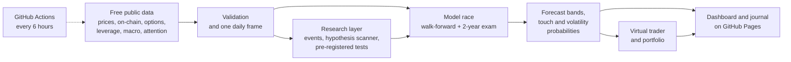

<div align="center">


# Bitcoin Barometer

**An honest, self-testing Bitcoin price forecast: ranges instead of guesses, explained like a weather report.**

[](https://github.com/wywigacz/bitcoin-predictor/actions/workflows/update.yml)
[](https://wywigacz.github.io/bitcoin-predictor/)


[](LICENSE)
[](https://github.com/wywigacz/bitcoin-predictor/stargazers)

[**Live dashboard**](https://wywigacz.github.io/bitcoin-predictor/) ·
[**Trader journal**](https://wywigacz.github.io/bitcoin-predictor/journal.html) ·
[Key findings](#key-findings) ·
[How it works](#how-it-works) ·
[Quick start](#quick-start) ·
[Research log](PLAN.md)

<a href="https://wywigacz.github.io/bitcoin-predictor/">
  <picture>
    <source media="(prefers-color-scheme: dark)" srcset="docs/img/dashboard-dark.png">
    
  </picture>
</a>

</div>

## Why this exists

Most Bitcoin "price predictions" give you one confident number and never look back. The Bitcoin Barometer does the
opposite. It forecasts the **whole range of likely prices** for 7 to 180 days ahead, explains it in plain English, and
**tests itself in public**, so you can see exactly how far to trust it, including where it fails.

It refreshes itself every 6 hours on GitHub Actions, uses only free public data, and needs no API keys or servers.

## Table of contents

- [Highlights](#highlights)
- [Key findings](#key-findings)
- [Screenshots](#screenshots)
- [How it works](#how-it-works)
- [Quick start](#quick-start)
- [Methodology in one minute](#methodology-in-one-minute)
- [Limitations](#limitations)
- [FAQ](#faq)
- [Contributing](#contributing)
- [About the author](#about-the-author)
- [Citation and license](#citation-and-license)

## Highlights

| | |
|---|---|
| **Probabilistic forecasts** | Price bands (P10 to P90) for 7, 30, 90 and 180 days, the chance of touching key levels, and the chance of a calm or stormy week. |
| **Pre-registered hypotheses** | 21 ideas (ETF flows, whale wallets, leverage, options skew, Wikipedia attention, news tone and more) written down *before* seeing results, with multiple-testing correction. |
| **2-year holdout exam** | Models are chosen only on data before Oct 29, 2024, then must beat a "no change" benchmark on the unseen last two years. |
| **Hundreds of free data sources** | On-chain metrics, Deribit options, Binance leverage and 5-minute candles, CFTC positioning, macro liquidity, ~250 global market series, Wikipedia attention, GDELT news tone. |
| **An external judge** | Touch probabilities are scored against real-money prediction markets (Polymarket, Kalshi). |
| **Virtual trader with a public journal** | Every ~6 hours it decides to buy, sell or wait, and writes down what it sees, what it does and when it would change its mind. |
| **Append-only ledger** | Every forecast is logged with its commit hash and scored when its horizon ends. Nothing is rewritten after the fact. |

## Key findings

Honest results matter more than impressive ones.

| Question | Answer |
|---|---|
| Can the **direction** of Bitcoin's price be predicted? | **No reliable edge.** Of 14 pre-registered direction hypotheses only weak momentum passed, and it adds nothing out of sample. A dedicated direction track also failed, so the dashboard says 50/50. |
| Can we predict **how volatile** the next week will be? | **Yes.** Volatility-event forecasts beat the "same as last time" benchmark both before and after the holdout cut-off. |
| Do volatility-aware price bands help? | **Yes**, at 7, 30 and 90 days: mean-reverting volatility scaling beat the square-root-of-time rule. |
| Who predicts price **touches** better, the model or the market? | **The market.** Polymarket's Brier score is 0.131 vs our 0.160 over the last two years. |
| Does active allocation beat regular buying (DCA)? | **Not convincingly.** It wins in about half of all 2-year windows, and the 90% confidence interval includes zero. |

The full research log, with every idea tried and why it was kept or dropped, is in [PLAN.md](PLAN.md).

## Screenshots

<table>
  <tr>
    <td width="60%"><br><sub><b>Forecast.</b> Pick any horizon and see the likely price range.</sub></td>
    <td width="40%" rowspan="2" align="center"><br><sub><b>Mobile first.</b> The whole dashboard works on a phone.</sub></td>
  </tr>
  <tr>
    <td><br><sub><b>In short.</b> The key takeaways in thirty seconds.</sub></td>
  </tr>
  <tr>
    <td><br><sub><b>Touch probabilities</b>, checked against what actually happened.</sub></td>
    <td><br><sub><b>Trader journal.</b> Every decision explained.</sub></td>
  </tr>
</table>

## How it works



A detailed tour of every module is in [docs/ARCHITECTURE.md](docs/ARCHITECTURE.md).

## Quick start

```bash
git clone https://github.com/wywigacz/bitcoin-predictor.git
cd bitcoin-predictor
pip install -r requirements.txt
python run.py            # incremental update + analysis + dashboard (docs/index.html)
python run.py --full     # rebuild the full history from scratch
```

Then open `docs/index.html` in a browser. Requirements: Python 3.11+, pandas, NumPy, SciPy, scikit-learn and requests.
No API keys. To run it on your own schedule, fork the repository: the included workflow updates the dashboard every
6 hours and publishes it with GitHub Pages (enable Pages from the `docs/` folder).

## Methodology in one minute

- **Walk-forward only.** Every model learns from data known on that day; feature selection happens inside the loop.
- **A fair benchmark.** "No change" is calibrated exactly like the models; comparisons use pinball loss and the
  Diebold-Mariano test with HAC and Harvey-Leybourne-Newbold corrections.
- **A significance gate.** A model influences the forecast only at p ≤ 0.10. Today none pass for direction, so the
  center of the forecast is the current price and the width comes from volatility.
- **Calibration checks.** About 80% of outcomes should land inside the P10 to P90 band, and coverage is audited
  separately in calm, average and stormy markets.
- **Leak tests.** Random features and a shuffled target give no edge, while a deliberate future leak gives +34%, which
  proves the pipeline would detect a real signal.

## Tech stack

Python (pandas, NumPy, SciPy, scikit-learn) · GARCH, HAR and HARQ volatility models · hidden Markov models · quantile
gradient boosting · ridge regression · kNN analogues · Monte Carlo path simulation · Brier and pinball scoring ·
static HTML with inline SVG and Chart.js · GitHub Actions and GitHub Pages.

## Limitations

- Bitcoin has had only four halving cycles, so long-horizon patterns rest on very few observations.
- Some volatility-model parameters are fitted on the full sample; this mildly affects band width, not direction.
- A few free sources (Google Trends, global M2) are missing or unreliable, and are skipped when unavailable.

## FAQ

**Is this investment advice?** No. It is an educational research project, and the trading portfolio is purely
virtual: no real money and no real orders.

**Why does it say 50% for the direction?** Because nothing we tested predicts direction reliably out of sample.
Showing a confident number would be dishonest.

**How often does it update?** Every 6 hours, automatically. The trader journal gets a new entry on each update.

**Can I use the data or code?** Yes, under the MIT license. A link back is appreciated.

## Contributing

Ideas, bug reports and pull requests are welcome; see [CONTRIBUTING.md](CONTRIBUTING.md). New signals are especially
welcome as **pre-registered hypotheses**: describe the idea and the expected sign before testing it.

## About the author


**Przemysław Wywigacz** ([@wywigacz](https://github.com/wywigacz)) · Life Automation

I build automation and data projects with AI-assisted engineering. This one is a public, end-to-end example of how I
approach forecasting problems: collect broad free data, state hypotheses up front, validate out of sample, and report
negative results as clearly as positive ones.

<br clear="left">

If this project is useful or interesting, **star the repository** and **follow me on GitHub** to see what I build next.

## Citation and license

If you use this work, please cite it (GitHub shows a "Cite this repository" button based on [CITATION.cff](CITATION.cff)).

Released under the [MIT License](LICENSE) © 2026 Przemysław Wywigacz.
